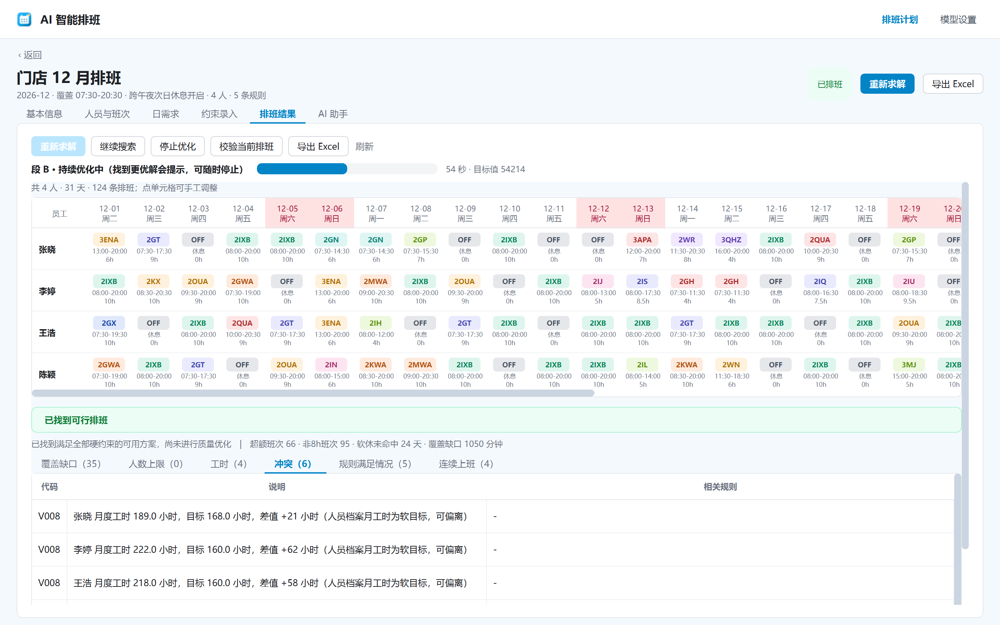
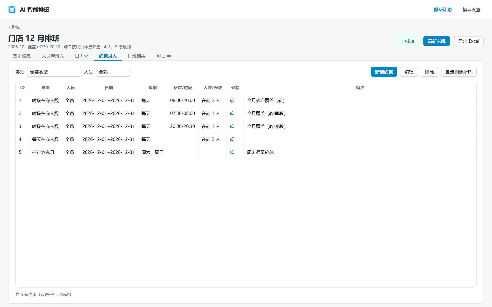

# AI 智能排班

基于 **OR-Tools CP-SAT** 与**自然语言约束**的桌面排班应用：用一句话描述排班要求，AI 解析为可校验的约束，求解器在后台给出可行排班并持续优化。

- 界面：PySide6（Qt for Python）原生桌面
- 存储：SQLModel + SQLite（本地单文件）
- 求解：OR-Tools CP-SAT 两阶段（可行性 + 质量优化）
- AI：兼容 OpenAI 接口的任意大模型（接口地址、模型名、API Key 在应用内配置）



## 功能

- **计划管理**：按月份建立排班计划，维护覆盖时段、核心时段、连续上班上限、求解预算等计划级设置。
- **人员与班次**：人员档案（月工时目标、每日上限、岗位、特殊班许可）；内置零售门店班次目录，也可自行新增或重新导入。
- **日需求**：日历式录入当天/整月/工作日/周末的人数需求，支持方向键选择、Enter 打开。
- **约束录入**：23 种规则类型，覆盖休息、必须上班、有薪假、固定班次、时段人数、上下班时刻人数、人数上限、周/月工时、连休与连续上班、工作时段窗、岗位条件班次等，均支持硬/软约束。
- **AI 助手**：
  - 自然语言约束解析：批量生成约束，先预览再写入；
  - 排班微调：把“11-12 只排 1 个人”之类的要求换算成约束变更并试算；
  - 冲突修复：针对冲突给出可执行的修复方案。
- **排班结果**：员工 × 日期网格，点击单元格可手工调整或锁定；后台持续优化，发现更优解时提示一键应用。
- **报告与导出**：覆盖缺口、人数上限、工时、冲突、规则满足情况、连续上班报告；一键导出 Excel（排班表 / 工时统计 / 未满足需求）。



## 快速开始

要求 Python 3.12+（已在 Windows 11 + Python 3.12 验证）。

```powershell
python -m venv .venv
.\.venv\Scripts\python.exe -m pip install -r backend\requirements.txt
.\.venv\Scripts\python.exe run_gui.py
```

## 配置 AI 模型

打开右上角 **模型设置**，填写：

- 接口地址，例如 `https://api.openai.com/v1` 或任意兼容 OpenAI 协议的服务地址
- 模型名称
- API Key

配置保存在本地数据库，不会写入代码或提交到仓库。未配置模型时，AI 助手不可用，其余排班功能不受影响。

## 构建 exe

```powershell
.\build\build.ps1
```

脚本会创建/复用根目录 `.venv`、安装依赖，再调用 PyInstaller（配置见 [build/app.spec](build/app.spec)），产出 `dist\AIShiftSchedule.exe`。

## 数据目录

- 默认：`%LOCALAPPDATA%\AIShiftScheduleContest\data.db`，日志写入同目录 `logs\app.log`
- 覆盖：设置环境变量 `AISHIFT_DATA_DIR` 指向其它目录

数据完全保存在本地，应用不会上传计划、人员或排班结果。

## 目录结构

```
run_gui.py                  桌面应用入口
backend/
  app/
    gui/                    Qt 界面层（工作区页签、排班网格、报告、AI 助手、设置页）
    services/               应用服务层（求解、校验、规则、导入导出、AI）
    models.py  schemas.py   SQLModel 数据模型与输入校验
    config.py  db.py        数据目录与数据库初始化
  resources/                图标、班次导入模板
  requirements.txt
build/
  app.spec                  PyInstaller 配置
  build.ps1                 一键打包脚本
docs/                       README 截图
```

## 技术要点

- **两阶段求解**：段 A 快速求可行解，段 B 在后台继续优化目标值，可随时停止或应用更优解。
- **可解释无解**：求解前做结构预检查，无解时返回冲突集与自然语言说明。
- **全体/个人规则**：休息、必须上班等规则支持“全员”范围，减少重复配置。
- **本地优先**：除 AI 解析外不依赖网络，数据留在本机。

## 许可证

[MIT](LICENSE)
